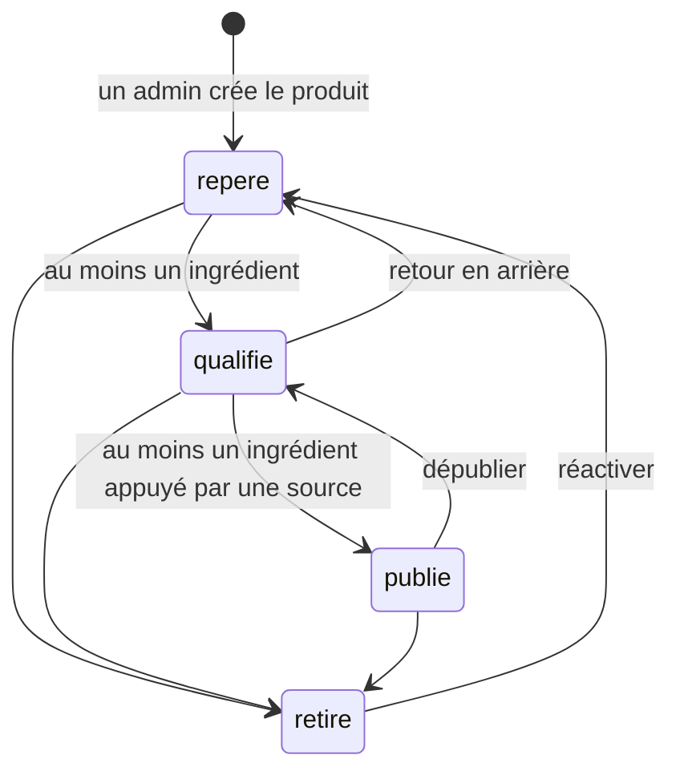

# Cycle de vie d'un produit

L'objet principal suivi par l'outil est le **produit**. Il passe par quatre statuts. Le serveur applique ces règles dans `src/lib/cycle-de-vie.ts`, testé par `src/lib/cycle-de-vie.test.ts`.

## Les statuts

| Statut | Ce qu'il veut dire | Qui le voit |
|---|---|---|
| **Repéré** | Le produit vient d'être trouvé ; sa fiche peut être incomplète. | Admin |
| **Qualifié** | Sa composition est connue (au moins un ingrédient). | Admin |
| **Publié** | Au moins un de ses ingrédients a une source. Il est montré aux lecteurs. | Admin, lecteur |
| **Retiré** | Le produit n'est plus suivi (arrêté, rejeté, hors sujet). | Admin |

## Qui a le droit de faire quoi

| Action | Admin | Lecteur |
|---|---|---|
| Créer un produit (toujours au statut « Repéré ») | oui | non |
| Modifier la fiche, ajouter une pièce jointe | oui | non |
| Changer le statut, selon les flèches ci-dessus | oui | non |
| Voir la liste, la fiche et les pièces jointes | tous les statuts | « Publié » seulement |

## Les règles qui tiennent

- On ne saute pas d'étape : « Repéré » ne passe pas directement en « Publié », « Retiré » ne revient qu'à « Repéré ».
- Une condition est vérifiée au moment du changement de statut **et** à chaque modification : on ne peut pas enlever le dernier ingrédient sourcé d'un produit publié sans l'avoir d'abord dépublié.
- Le statut ne se choisit pas dans le formulaire du produit : il ne change que par les boutons du bloc « Cycle de vie », sur la fiche.
- Si deux admins changent le statut en même temps, le second reçoit « Le statut a changé entre-temps » au lieu d'écraser le premier.
- Un lecteur qui ouvre l'adresse d'un produit non publié, ou d'une de ses pièces jointes, est refusé ; la tentative est écrite dans les journaux (`acces_refuse`, action `voir_produit` ou `telecharger_piece_jointe`).
- Chaque changement est journalisé (`statut_change`), ainsi que chaque refus (`statut_refuse`).
